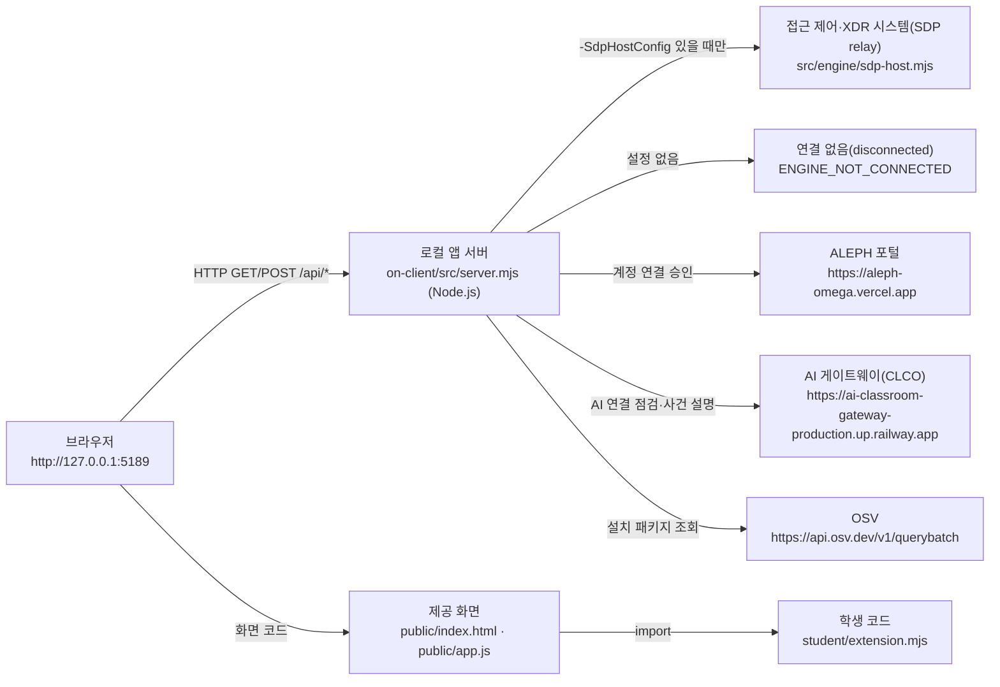

# 케셰브 보안 Agent 실행 설명서 (학생 작성 · 권빈)

이 문서는 학생 **권빈**이 직접 작성한 실행 설명서입니다. 제공 문서(`README.md`, `docs/STUDENT_LAUNCH_GUIDE.md`, `docs/CONNECTION_TROUBLESHOOT.md` 등)는 수정하지 않았습니다. 보안 Agent 이름은 「빈」입니다.

- 저장소: https://github.com/kwonbhin/choi-bujang-secret-vault
- 앱 폴더: 저장소 안의 `on-client` (시작 틀 `alekov-client-starter` 0.2.19, `package.json` 기준)
- Git 최상위 폴더: 저장소 폴더(`choi-bujang-secret-vault`). 커밋·제출은 여기서 합니다.

> 표기 규칙: **[실제 확인]** = 학생 PC에서 직접 실행하거나 화면으로 본 것, **[코드 확인]** = 커밋된 코드를 읽고 확인한 것(실행하지 않음), **[모의 점검]** = 가짜 입력으로 학생 함수만 실행해 본 것, **미확인** = 확인하지 못한 것.

---

## 1. 이 앱이 하는 일

직원이 자기 PC에서 켜는 보안 앱입니다. 브라우저 화면에서 다음을 보여 줍니다.

| 메뉴 | 보여 주는 것 | 학생 함수 |
|---|---|---|
| 보호 현황 | 내 계정·기기·세션, 알림·진단, AI 연결 점검, 설치 패키지 취약점 조회 | `renderIdentity`, `renderStatus`, `renderAiConnection`, `renderVulnerabilities` |
| 업무 앱 | 업무 앱 접근 판정(allow·deny·challenge·unknown) | `renderDecision` |
| 보안 기록 | 접속 기록·XDR 경보 목록과 상세, AI 사건 설명, 조치 요청 상태 | `renderEvents`, `renderExplanation`, `renderAction` |

---

## 2. 필요 프로그램과 확인한 버전

| 프로그램 | 요구 | 학생 PC에서 확인한 값 |
|---|---|---|
| Windows PowerShell | 실행 도구 `tools/start-alekov.ps1` 실행 | Windows PowerShell 사용 **[실제 확인]** |
| Node.js | 22~24 (수업 기준 24.19.0, `package.json`의 `engines.node`) | `node --version` → **v24.19.0** **[실제 확인]** (2026-10-26, 22단계 새 폴더 재현) |
| Git | `git pull`·커밋 | `git pull` 정상 동작 **[실제 확인]** (버전 번호는 미확인) |
| 브라우저 | PC 브라우저 | 사용함 **[실제 확인]** |
| npm 패키지 | 외부 의존성 없음(`package.json`에 dependencies 없음) | **[코드 확인]** |

---

## 3. 폴더 구조 (학생 PC 실제 위치)

```
C:\Users\Administrator\Documents\choi-bujang-secret-vault\   ← Git 최상위 (1~12단계 자료실 + 4차 앱)
├─ README.md                 ← 학생 README (4차 요약 포함)
├─ package-lock.json         ← 1~12단계 자료실의 lock 파일
└─ on-client\                ← 앱 폴더 (여기서 PowerShell 실행)
   ├─ package.json           ← alekov-client-starter 0.2.19, 스크립트 start·demo·check
   ├─ .on-starter-manifest.json ← 제공 파일 해시 목록 (수정 금지)
   ├─ tools\start-alekov.ps1 ← 실행 도구 (제공)
   ├─ src\server.mjs         ← 로컬 앱 서버 (제공)
   ├─ src\engine\            ← 접근 제어·XDR(SDP) 연결 (제공)
   ├─ src\ai\                ← AI 게이트웨이 연결 (제공)
   ├─ src\connection\        ← 계정 연결(native login) (제공)
   ├─ src\vulnerabilities\   ← package-lock.json·OSV 대조 (제공)
   ├─ public\index.html, app.js, vulnerabilities-view.mjs … ← 제공 화면
   ├─ student\extension.mjs  ← ★ 학생 작성 코드 (13~20단계 함수)
   ├─ student\engine-adapter.mjs ← SDP 설정이 있을 때만 쓰는 어댑터
   └─ docs\STUDENT_RUNBOOK.md ← 이 문서 (학생 작성)
```

경로 `C:\Users\Administrator\Documents\choi-bujang-secret-vault`는 2026-10-26 PowerShell 프롬프트에서 본 실제 경로입니다 **[실제 확인]**. 다른 PC에서는 저장소를 받은 위치로 바꿔 읽습니다.

---

## 4. 실행 순서

### 4-1. 최신 코드 받기

1. 파일 탐색기에서 `choi-bujang-secret-vault` 폴더를 엽니다.
2. 주소 표시줄에 `powershell`을 입력하고 Enter를 누릅니다.
3. 아래를 실행합니다.

```powershell
git pull
```

`Fast-forward` 또는 `Already up to date.`가 나오면 정상입니다 **[실제 확인]**.

> 주의: 받은 ZIP(`alekov-starter-0.2.19.zip`)의 안쪽 폴더에서는 실행하지 않습니다. ZIP 안에는 학생 코드가 없고, 압축된 상태로는 실행할 수 없습니다.

### 4-2. 앱 켜기

```powershell
cd on-client
powershell -NoProfile -ExecutionPolicy Bypass -File .\tools\start-alekov.ps1
```

`-ExecutionPolicy Bypass`는 이번 실행에만 적용됩니다.

**정상 시작 신호** (2026-10-26 실제 출력) **[실제 확인]**:

```
계정 연결 준비가 끝났습니다. 앱에서 확인 번호로 로그인·승인을 진행하세요.
케셰브 연결 확인: http://127.0.0.1:5189
케셰브가 켜졌습니다. 브라우저에서 http://127.0.0.1:5189/ 을 여세요.
서버가 응답한 것만 확인했습니다. AI 연결 상태는 화면에서 따로 확인해 주세요.
끄려면 이 창에서 Ctrl+C 를 누르세요.
```

`{"event":"alekov_native_connect_diagnostic",...,"code":"ALEKOV_CONNECT_CANCELLED"}` 같은 JSON 줄이 함께 나올 수 있습니다. 이 줄은 연결 찾기 과정이 취소됐다는 진단 기록이고, 서버는 계속 켜져 있었습니다 **[실제 확인]**. 정확한 원인은 미확인입니다.

### 4-3. 브라우저 열기

- 주소: **http://127.0.0.1:5189/** (서버는 `127.0.0.1`에서만 열립니다. `src/server.mjs` 840행 **[코드 확인]**)
- 위쪽 상태 표시와 「보호 현황」·「업무 앱」·「보안 기록」 메뉴가 보이면 정상입니다 **[실제 확인]**.

### 4-4. 계정 연결과 AI 연결 (선택, 17단계 이후 기능)

1. 보호 현황의 계정 연결 칸에서 「계정 연결 시작」을 누르고 확인 번호를 봅니다. ALEPH 포털에서 같은 계정으로 같은 번호를 확인한 뒤 「로그인 확인 완료」를 누릅니다(상태만 볼 때는 「현재 로그인 확인」, 멈출 때는 「계정 연결 취소」).
2. AI 연결 칸에서 「AI 연결 시작」 → 「승인 페이지 열기」 → 「승인했으며 연결 확인」을 누릅니다.
3. 「AI 연결 점검」을 누릅니다.

버튼 이름은 `public/index.html` 원문과 대조했습니다 **[코드 확인]**.

2026-10-26 결과 **[실제 확인]**: `앱 권한 확인 후 모델 응답 점검(verified)`, 응답 모델 수 1, 점검 시각 `2026-10-26T06:37:39.158Z`. 화면에는 "이 점검은 사건 설명을 실행하지 않았습니다"도 함께 나왔습니다. 즉 연결 점검만 성공했고, 사건 설명 실행은 별개입니다.

### 4-5. 종료와 재실행

| 동작 | 방법 |
|---|---|
| 종료 | 앱을 켠 PowerShell 창에서 `Ctrl+C`. 브라우저 주소가 더 열리지 않으면 꺼진 것 |
| 재실행 | 같은 `on-client` 폴더에서 4-2 명령을 다시 실행 |
| 코드 갱신 뒤 재실행 | `Ctrl+C`로 끄고 → 저장소 폴더에서 `git pull` → `on-client`에서 4-2 명령 |
| 창 없이 실행 | 명령 끝에 ` -Background`. 안내된 프로세스 번호의 node를 작업 관리자에서 종료 (`tools/start-alekov.ps1` **[코드 확인]**, 학생은 미사용) |
| 포트 변경 | 명령 끝에 ` -Port 5190`, 브라우저도 `:5190` (**[코드 확인]**, 미사용) |
| 예제 자료로 화면 보기 | 명령 끝에 ` -Demo` 또는 `npm run demo`. 예제 자료이며 실제 연결이 아님 (**[코드 확인]**, 미사용) |
| 문법만 검사 | `npm run check` (`node --check student/extension.mjs`) |

실행·종료는 학생 파일을 바꾸지 않습니다.

---

## 5. 시스템 구성도

### 5-1. Mermaid



### 5-2. 같은 내용을 글로 (ASCII)

```
[브라우저 http://127.0.0.1:5189]
     │  화면: public/index.html + public/app.js(제공) → student/extension.mjs(학생) 함수로 학생 칸을 그림
     │  자료: /api/me /api/apps /api/events /api/devices /api/sessions /api/access
     │        /api/ai/check /api/ai/explain /api/actions/{prepare,execute,result}
     │        /api/vulnerabilities /api/diagnostics /api/pc/status
     ▼
[로컬 앱 서버 src/server.mjs, 127.0.0.1 에서만 수신]
     ├─▶ 접근 제어·XDR 시스템(SDP relay) ─ src/engine/sdp-host.mjs, -SdpHostConfig 지정 실행에서만
     │     (설정이 없으면 "연결 없음" · ENGINE_NOT_CONNECTED)
     ├─▶ ALEPH 포털 https://aleph-omega.vercel.app ─ 계정 연결·AI 앱 승인 (src/connection/, src/ai/connection.mjs)
     ├─▶ AI 게이트웨이(CLCO) https://ai-classroom-gateway-production.up.railway.app ─ 연결 점검·사건 설명 (src/ai/)
     └─▶ OSV https://api.osv.dev/v1/querybatch ─ package-lock.json 의 승인된 공개 패키지만 (src/vulnerabilities/)
```

### 5-3. 표

| 출발 | 도착 | 무엇을 | 관련 파일 | 현재 상태 |
|---|---|---|---|---|
| 브라우저 | 로컬 앱 서버 | 화면·`/api/*` 요청 | `public/app.js` | 동작 **[실제 확인]** |
| 로컬 앱 서버 | 접근 제어·XDR(SDP) | 사용자·기기·세션·앱 판정·보안 기록 | `src/engine/sdp-host.mjs`, `student/engine-adapter.mjs` | 연결 없음. 화면에 "기존 서버·에이전트의 연결을 확인할 수 없습니다" **[실제 확인]**. SDP 설정 파일은 담당자가 발급 |
| 로컬 앱 서버 | ALEPH 포털 | 계정 연결·AI 앱 승인 | `src/connection/`, `src/ai/connection.mjs` | 승인 완료 **[실제 확인]** |
| 로컬 앱 서버 | AI 게이트웨이(CLCO) | 연결 점검, 사건 설명 | `src/ai/service.mjs` | 연결 점검 verified **[실제 확인]**. 사건 설명은 보안 기록이 없어 미확인 |
| 로컬 앱 서버 | OSV | 설치 패키지 취약점 조회 | `src/vulnerabilities/osv.mjs`, `project-scan.mjs` | 기본 실행에는 `ON_PROJECT_DIRECTORY`가 없어 `not_configured`(PROJECT_NOT_CONFIGURED)가 나올 것으로 보임 **[코드 확인]**. 화면은 미확인 |

비밀 설정(계정 연결 설정·앱 자격·SDP 인증서)은 학생 프로젝트 밖의 Windows 사용자 폴더에 보관되며 이 문서와 Git에 넣지 않습니다. 저장소 `.gitignore`는 `.env`, `.env.*`를 제외합니다. 제공 `README.md`에는 `.env.example`이 언급되지만, 0.2.19 `on-client` 폴더에는 그 파일이 없습니다 **[코드 확인]**.

---

## 6. 제공 코드와 학생 작성 코드의 경계

| 구분 | 파일 | 학생이 고쳤나 |
|---|---|---|
| 제공 | `src/**`, `public/**`, `tools/**`, `vendor/**`, `.on-starter-manifest.json`, 제공 `docs/*.md`, `README.md`, `package.json` | 아니오 |
| 학생 | `student/extension.mjs` | 예 (13~20단계) |
| 학생 | `docs/STUDENT_RUNBOOK.md` (이 문서), 저장소 최상위 `README.md`의 4차 절 | 예 (21단계) |

### 학생이 구현한 함수 (`student/extension.mjs`)

| 단계 | 함수 | 하는 일 | 확인 수준 |
|---|---|---|---|
| 13 | `renderIdentity` | 내 계정·기기·세션, 한국어 상태 + 원래 코드값 | 코드 판정 받음(포털 기록 참고) |
| 14 | `renderDecision` | 업무 앱 판정, 요청 실패를 거부와 구분 | 코드 판정 받음(포털 기록 참고) |
| 15 | `renderEvents` | 기록 목록 최신순·필터·상세(`data-student-event-id`·`data-student-event-detail`) | 코드 판정 받음(포털 기록 참고) |
| 16 | `renderStatus` | 기기·세션·알림·진단, 「도움정보 복사」(안전한 6개 값만) | 코드 판정 받음(포털 기록 참고) |
| 17 | `renderAiConnection` | AI 연결 점검 결과, 오류 code별 안내 | 화면 verified **[실제 확인]** |
| 18 | `renderExplanation` | AI 설명을 근거 ID·규칙·현재 상태와 대조. 불일치·`executed:true`는 거부, unknown은 확인 불가 | 기록 미선택 안내 화면 **[실제 확인]**, 나머지는 **[모의 점검]** 10가지 |
| 19 | `renderAction` | 준비됨·미실행 / 전달 중 / 접수(ACK) / 효과 확인 구분. 사건·조치 ID 불일치·누락이면 결과 불명 | **[모의 점검]** 12+8가지, 화면 미확인 |
| 20 | `renderVulnerabilities` | lock 파일 기준 정확한 버전, complete·partial·not_checked·not_configured·unverifiable 구분 | **[모의 점검]** 8가지(제공 `normalizeScan` 통과 입력), 화면 미확인 |

공통 규칙: 모든 학생 함수는 `document.createElement`와 `textContent`만 씁니다(innerHTML 없음). 매번 새 요소를 만들어 돌려주고, 호출부가 통째로 교체하므로 이전 결과가 남지 않습니다. 학생 코드는 조치 버튼·POST 요청·확인 티켓을 만들지 않습니다.

---

## 7. 오류별 확인 순서

> 버튼 이름 차이: 19단계 과제 안내에는 「연동 시스템 결과만 재조회」라고 적혀 있지만, 실제 화면(`public/index.html`)의 버튼은 **「원천 결과만 재조회」**입니다. 이 문서와 학생 코드는 실제 버튼 이름을 씁니다.

화면이나 PowerShell에 나온 문구·코드로 찾습니다. 출처: 실행 도구 메시지(`tools/start-alekov.ps1`), 서버·화면 오류 코드(`src/server.mjs`, `public/app.js`), 제공 문서 `docs/CONNECTION_TROUBLESHOOT.md`.

| 증상 / 코드 | 원인 | 학생이 확인할 것 | 복구 |
|---|---|---|---|
| `Node.js 가 없습니다` / `지금 Node.js 는 vXX 입니다` | Node 없음·버전 범위 밖 | `node --version` | Node.js 24.19.0 설치 → 새 PowerShell 창 |
| `포트 5189 를 다른 프로그램이 쓰고 있습니다` | 포트 충돌 | 이미 켠 창이 있는지 | 기존 창 `Ctrl+C` 또는 `-Port 5190` |
| `앱 폴더가 아닙니다` / `시작 틀 폴더가 아닙니다` | 실행 위치 오류(저장소 최상위·ZIP 안에서 실행) | 현재 폴더에 `tools\start-alekov.ps1`이 있는지 | `cd on-client` 뒤 실행 |
| `앱 서버가 …초 안에 뜨지 않았습니다` | 서버 시작 실패 | 창의 메시지 전체 | 메시지와 「도움정보」를 담당 강사에게 |
| 화면: "기존 서버·에이전트의 연결을 확인할 수 없습니다" / `ENGINE_NOT_CONNECTED` | SDP 설정 없음 | 정상(학생이 설정하지 않음) **[실제 확인]** | 담당자가 SDP 설정을 발급할 때까지 대기. 학생 코드 문제 아님 |
| `ON_AI_PROVISIONING_PENDING` | 앱 권한·계정 연결 준비 안 됨 | 4-4 순서를 마쳤는지 | 계정 연결부터 다시 |
| `WB_CLCO_RATE_LIMITED`, `WB_CLCO_TIMEOUT` | 요청 제한·시간 초과 | 인터넷 연결 | 잠시 뒤 직접 다시(자동 재시도 없음) |
| `WB_CLCO_SESSION_CLOSED` | 이용 시간 아님 | 이용 시간 | 시간 안에 다시 |
| AI 설명: `ON_AI_INVALID_INPUT` | 사건 근거·규칙 부족 | 학생 칸 "근거 부족·입력 오류" | 다른 기록 선택. 기록은 그대로 |
| AI 설명: `ON_AI_INVALID_OUTPUT` | AI 응답 근거 불일치·형식 오류 | 학생 칸 "근거 불일치" | 유료 요청을 반복하지 않음 |
| 조치: `ACTION_TIMEOUT` / 결과 불명(unknown) | 전달 뒤 결과 확인 불가 | 학생 칸 "결과 불명" | 다시 집행하지 말고 「원천 결과만 재조회」 |
| 조치: `ACTION_CONFIRMATION_EXPIRED` | 사람 확인 기한 지남 | 학생 칸 "확인 기한 지남(expired)" | 조치를 다시 준비 |
| 패키지: `not_configured` / `PROJECT_NOT_CONFIGURED` | 조회 대상 프로젝트 설정 없음 | 정상(운영자 준비 항목) | 학생이 설정을 바꾸지 않음 |
| 패키지: `not_checked` / `NO_APPROVED_PACKAGES` | 승인된 공개 패키지 없음 | 정상(운영자 준비 항목) | 취약점을 만들려고 의존성을 낮추지 않음 |
| 패키지: `CANCELLED` / `TIMEOUT` | 조회 취소·시간 초과 | 학생 칸 "조회 취소/실패" (취약점 없음 아님) | 「설치 패키지 조회」를 직접 다시 |
| `student/extension.mjs를 불러오지 못했습니다` | 학생 파일 문법 오류 | `npm run check` | 오류 줄 수정 뒤 재실행 |

---

## 8. 확인한 것과 확인하지 못한 것

| 항목 | 상태 | 근거 |
|---|---|---|
| 4-2 명령으로 서버 시작, 정상 시작 신호 | **[실제 확인]** 2026-10-26 | PowerShell 출력 |
| 브라우저에서 화면·메뉴 표시 | **[실제 확인]** | 화면 |
| 계정 연결·AI 앱 승인·AI 연결 점검 verified | **[실제 확인]** | 화면(점검 시각 2026-10-26T06:37:39.158Z) |
| SDP 미연결 시 "연결 없음"과 다른 메뉴가 계속 동작함 | **[실제 확인]** | 화면 |
| 18단계 기록 미선택 안내 | **[실제 확인]** | 화면 |
| 실제 보안 기록 조회 | **미확인**: SDP 연결 없음 | — |
| 실제 AI 사건 설명(근거 ID 일치) | **미확인**: 기록이 없어 요청 불가 | — |
| 실제 조치 준비·집행·결과 재조회 | **미확인(기다림)**: 집행 연동 시스템 미준비. 시험 집행도 하지 않음 | — |
| 19단계 학생 칸 화면 | **미확인** | — |
| 20단계 설치 패키지 조회 화면, package-lock.json 버전 대조 | **미확인** | — |
| `-Demo`, `-Background`, `-Port` 실행 | **미확인**(사용하지 않음) | 코드만 읽음 |
| Node.js 정확한 버전 출력 | **[실제 확인]** v24.19.0 | 22단계 재현 기록 |
| 같은 PC의 새 폴더에서 처음부터 재현 | **[실제 확인]** 최종 커밋 `4122f41` (다른 PC는 미확인) | [REPRODUCTION_RECORD.md](REPRODUCTION_RECORD.md) 3-4 |
| Windows 외 환경(macOS·Linux)에서 실행 도구 | **지원 범위 밖·미확인**: 실행 도구는 Windows PowerShell 전용 | `tools/start-alekov.ps1` |

이 표의 "미확인"은 실패가 아니라 확인하지 못했다는 뜻이며, 확인했다고 적지 않았습니다.
